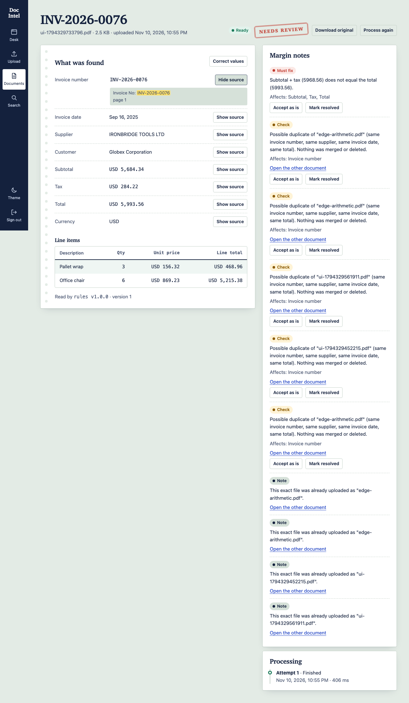

# Document Intelligence

[](https://github.com/rjporosh/SeniorAiEngineerTaskCareGuide/actions/workflows/ci.yml)

Upload invoices as PDFs, scans, photos, spreadsheets or CSV files. The system reads them (text extraction and OCR), finds the invoice fields, checks the numbers, flags anything doubtful, and lets a person review, correct and search — with every change audited.



| Capability | How it works |
|---|---|
| Ingest | Multi-file upload; extension, MIME **and** file-signature checks; size/page/row/sheet/time limits; corrupt or hostile files are rejected without affecting the batch |
| Read | Digital PDFs use embedded text; scanned/hybrid pages are OCR'd page by page (Tesseract, **English + Bengali**); images are deskewed and contrast-enhanced; TIFF multi-frame; XLSX/XLS/CSV keep sheet and cell coordinates; formulas and macros are never executed |
| Extract | Switchable extractor: deterministic **rules**, a local **Ollama** model (`qwen2.5-coder:14b`) or **OpenAI**; versioned invoice schema with field-level evidence and confidence; every model value must be found in the document, unknown or ambiguous values stay `null` (never guessed) |
| Validate | Required fields, decimal-safe subtotal + tax = total, line sums, credit notes, duplicates, PDF↔spreadsheet cross-checks; anything doubtful sets *needs review* |
| Review | Edit values with optimistic concurrency, accept or resolve issues, reprocess without losing history |
| Search | Keyword (PostgreSQL full-text / MongoDB text) and semantic (pgvector) search with filters and page/sheet/cell locations |
| Operate | Switchable database (PostgreSQL · MongoDB · in-memory) and queue (RabbitMQ · BullMQ) by configuration only; outbox pattern; JSON logs, Prometheus metrics, OpenTelemetry traces |

## Live demo

**Live demo:** _not published yet._ Create it in one click with [**Deploy to Render**](https://render.com/deploy?repo=https://github.com/rjporosh/SeniorAiEngineerTaskCareGuide) (uses the schema-validated `render.yaml`; details and the Vercel option are in [docs/deployment.md](docs/deployment.md)), verify it with `node scripts/check-deployment.mjs`, then replace this line with your URL. Free instances sleep when idle, so the first load can take about a minute.

**Demo sign-in** (reviewer role, public on purpose, only valid on a deployment that seeds it):

| Email | Password |
|---|---|
| `demo@docint.example` | `Recruiter-Demo-2026` |

Try it with the files in `fixtures/synthetic/` (for example `edge-arithmetic.pdf`, `scanned-01.pdf`, `sheet-01.xlsx`). Do not upload real documents to a public demo.

## Quick start

Requires Docker (Compose v2). Nothing else is needed on your machine.

```bash
cp .env.example .env
# edit .env: replace every CHANGE_ME value (generate secrets with: openssl rand -hex 32)
docker compose up --build
```

Open **http://localhost:4001** and sign in with `SEED_ADMIN_EMAIL` / `SEED_ADMIN_PASSWORD` from your `.env`. Upload a file from `fixtures/synthetic/` to try it.

| Service | Where | Notes |
|---|---|---|
| Web UI | http://localhost:4001 | `WEB_PUBLIC_PORT` |
| API | http://localhost:4000/api/v1 | `API_PUBLIC_PORT` |
| API reference (Scalar) | http://localhost:4000/api/docs | titled OpenAPI reference; Swagger UI at `/api/swagger`, raw spec at `/api/docs/openapi.json` (`API_DOCS_ENABLED=true`) |
| PostgreSQL, RabbitMQ, MinIO, processor | private network only | no host ports (see `compose.dev.yaml` for developer ports) |

Optional: `docker compose --profile observability up -d` adds Jaeger (http://localhost:16686), Prometheus (:9090) and Grafana (http://localhost:3030).

## AI extraction: Ollama or OpenAI (switch in `.env`)

```env
EXTRACTOR_PROVIDER=rules     # rules | ollama | openai
# Local model (free, private): ollama pull qwen2.5-coder:14b
OLLAMA_BASE_URL=http://host.docker.internal:11434
OLLAMA_MODEL=qwen2.5-coder:14b
# Hosted: set EXTRACTOR_PROVIDER=openai and OPENAI_API_KEY (OPENAI_BASE_URL also accepts any OpenAI-compatible server)
OPENAI_MODEL=gpt-4o-mini
```

Apply with `docker compose up -d --force-recreate api`. The model only *proposes* values: each one must appear in the document text, amounts and dates pass the same deterministic normalisers as the rules, the rules run alongside as a cross-check (a disagreement raises a review warning), and the rules take over if the model is unreachable (`LLM_FALLBACK_TO_RULES`). Document text is passed as delimited untrusted data, so instructions hidden in an invoice cannot change the result. Model, version and prompt version are stored with every extraction. Details: [docs/llm.md](docs/llm.md).

**Bengali:** OCR reads English and বাংলা together (`OCR_LANGUAGES=eng+ben`). Field extraction for Bengali documents uses the Ollama/OpenAI extractor (the rules know English labels only).

## Run from published Docker images

Every push to `main` that passes CI publishes multi-arch (amd64/arm64) images to GitHub Container Registry:

| Image | Pull |
|---|---|
| Web UI (Next.js) | `docker pull ghcr.io/rjporosh/docint-web:latest` |
| API (NestJS) | `docker pull ghcr.io/rjporosh/docint-api:latest` |
| Document processor (OCR) | `docker pull ghcr.io/rjporosh/docint-processor:latest` |

Package pages: [web](https://github.com/rjporosh/SeniorAiEngineerTaskCareGuide/pkgs/container/docint-web) · [api](https://github.com/rjporosh/SeniorAiEngineerTaskCareGuide/pkgs/container/docint-api) · [processor](https://github.com/rjporosh/SeniorAiEngineerTaskCareGuide/pkgs/container/docint-processor). The whole stack (web **and** api **and** processor plus PostgreSQL, RabbitMQ, MinIO) starts from them with no build:

```bash
cp .env.example .env            # replace every CHANGE_ME value
docker compose -f compose.yaml -f compose.images.yaml pull
docker compose -f compose.yaml -f compose.images.yaml up -d --wait
```

The **UI is at http://localhost:4001** (the web container; the API at :4000 has no UI). If the images are private after the first publish, set each package to *Public* once (GitHub → Packages → Package settings → Change visibility).

## Switching providers (no code changes)

Set these in `.env` and run `docker compose up -d --force-recreate api`:

```env
DATABASE_PROVIDER=postgres   # postgres | mongodb | memory   (memory: tests/dev only, refused in production)
QUEUE_PROVIDER=rabbitmq      # rabbitmq | bullmq
OBJECT_STORAGE_PROVIDER=minio  # minio | local
```

Start the matching containers: `docker compose --profile mongodb --profile bullmq up -d`. Invalid or incomplete settings stop the API at start-up with a message naming the variable.

All six database × queue combinations were verified end to end (`scripts/verify-providers.sh`). Semantic search needs vectors: it works on PostgreSQL and in-memory and is reported as unavailable on MongoDB (the UI hides the toggle).

## Everyday commands

```bash
pnpm install                      # workspace dependencies (pnpm 12)
pnpm --filter @docint/api test    # API unit + HTTP tests
pnpm --filter @docint/web test    # UI component tests
./scripts/test-integration.sh     # PostgreSQL/MongoDB/RabbitMQ/Redis contract tests (starts containers)
docker build --target test -t docint-processor-test services/document-processor && \
  docker run --rm -e PROCESSOR_SERVICE_TOKEN=test-token-0123456789 docint-processor-test   # processor tests
pnpm --filter @docint/e2e test    # browser journeys (needs the stack running)
node scripts/evaluate.mjs         # accuracy/latency evaluation → docs/evaluation-report.md
./scripts/run-load.sh             # k6 load, spike, upload and stress suites
```

See [docs/operations.md](docs/operations.md) for migrations, backups and troubleshooting, and [docs/testing.md](docs/testing.md) for the test strategy.

## Documentation

| | |
|---|---|
| [docs/architecture.md](docs/architecture.md) | Components, data flow, trust boundaries, design decisions |
| [docs/api.md](docs/api.md) | Endpoints, response envelope, request/response examples |
| [docs/database-schema.md](docs/database-schema.md) | Logical model, indexes, migrations |
| [docs/security.md](docs/security.md) | Threat model and implemented controls |
| [docs/operations.md](docs/operations.md) | Run, observe, migrate, back up, troubleshoot |
| [docs/testing.md](docs/testing.md) | Test pyramid and exact commands |
| [docs/performance.md](docs/performance.md) | Measured load/stress/OCR results |
| [docs/evaluation-report.md](docs/evaluation-report.md) · [docs/evaluation-report-llm.md](docs/evaluation-report-llm.md) | Measured extraction accuracy, rules and Ollama (generated) |
| [docs/llm.md](docs/llm.md) | Choosing and configuring the extraction model, safety design |
| [docs/walkthrough.md](docs/walkthrough.md) | Demo script |
| [docs/deployment.md](docs/deployment.md) | Free demo hosting (Render blueprint, Vercel, Northflank) and the demo account |
| [docs/ai-assistance.md](docs/ai-assistance.md) | How AI assistance was used |

## Technology decisions

Versions were checked against the package registries on 2026-11-10 and pinned (lockfiles, exact image tags). Stable releases only.

| Area | Choice | Why |
|---|---|---|
| API | NestJS 12.4, TypeScript 6.0, Node 24 LTS | Node 24 is the newest line the pinned Prisma 7.10 supports (it warns on 26). TypeScript 6.0 satisfies `@nestjs/swagger`'s peer range; 7.x does not yet |
| Web | Next.js 16.4 (App Router), React 19.3 | Server-side BFF keeps tokens out of browser JavaScript |
| Processor | Python 3.13, FastAPI, PyMuPDF, Tesseract 5.5, OpenCV, openpyxl, xlrd | Best-in-class bounded parsers; internal service only |
| Database | PostgreSQL 18 + pgvector (Prisma 7.10 migrations); MongoDB 8.2 (Mongoose 9); `mongo:8`/`8.0` refuse to start on Linux kernels 6.19+ (SERVER-121912), so 8.2 is pinned | Canonical relational schema; document store as an alternative |
| Queue | RabbitMQ 4.1 (amqplib 2) · BullMQ 6 on Redis 8 | Different delivery semantics; only the application contract is normalised |
| Storage | S3-compatible (MinIO) or local filesystem | Files never live in the database |
| Tests | Vitest 5, pytest 9, Playwright 1.65, k6 1.3 | |

Official documentation: [NestJS](https://docs.nestjs.com) · [Next.js](https://nextjs.org/docs) · [Prisma](https://www.prisma.io/docs) · [PostgreSQL](https://www.postgresql.org/docs/18/) · [pgvector](https://github.com/pgvector/pgvector) · [RabbitMQ](https://www.rabbitmq.com/docs) · [BullMQ](https://docs.bullmq.io) · [Tesseract](https://tesseract-ocr.github.io/) · [PyMuPDF](https://pymupdf.readthedocs.io) · [OpenTelemetry](https://opentelemetry.io/docs/) · [k6](https://grafana.com/docs/k6/latest/).

## Known limitations

- **The default extractor is rule-based** and understands English labels only; `EXTRACTOR_PROVIDER=ollama|openai` adds a model (see [docs/llm.md](docs/llm.md)). A local 14B model needs roughly 20–30 s per text-heavy document on a laptop, so it is slower than the rules. Measured accuracy of both is in the evaluation reports (synthetic data).
- Bengali: OCR is verified on clean synthetic renders only; Bengali handwriting and noisy photos are untested. Mixed Latin/Bengali tokens inside one word can be misread.
- OCR quality drops on blurred or rotated photos (see the evaluation report); low OCR confidence is surfaced as a review reason, not hidden.
- Semantic search uses a deterministic hashing embedding (lexical similarity), not a language model.
- Multi-invoice files: the first invoice is extracted and the file is flagged. Multi-row spreadsheets are searchable and cross-checked per row but produce no single invoice.
- Line items can be viewed but not edited in the UI (the API accepts them).
- MongoDB (standalone) has no multi-document transactions; the outbox write uses a compensating delete. Semantic search is unavailable on MongoDB.
- RabbitMQ delayed retries use per-message TTL, which can delay a short retry behind a longer one in the same retry queue.
- The compose stack pins `bitnamilegacy/minio` because MinIO no longer publishes a pullable official image; for production use your own S3.
- Not published yet: no hosting account was available, so there is no live URL. `render.yaml` (schema-validated), a Vercel config and a verification script are provided; see [docs/deployment.md](docs/deployment.md). The web app needs a reachable API, so Vercel/Netlify alone cannot host the whole product.
- PyMuPDF is AGPL-licensed; review that before distributing a closed-source build.
- The 1,000-page limit is tested for digital PDFs (see performance report); OCR time scales with the number of scanned pages.

## License

See [LICENSE](LICENSE).
