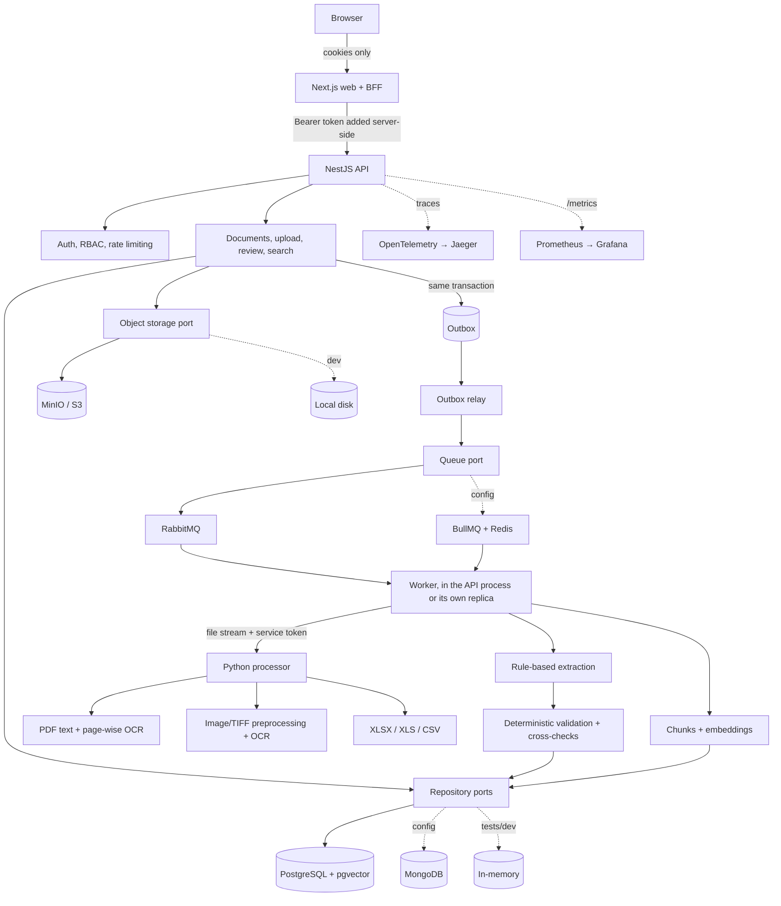

# Architecture

## Layers (API)

| Layer | Folder | Rule |
|---|---|---|
| Domain | `apps/api/src/domain` | Entities, money (decimal.js), normalisation, embeddings. No framework imports |
| Application | `src/application`, `src/validation`, `src/extraction`, `src/processing` | Ports (repositories, queue, storage), use cases, pure validation and extraction |
| Infrastructure | `src/infrastructure` | Prisma/Mongoose/memory repositories, RabbitMQ/BullMQ, S3/local storage — chosen **once** at bootstrap by `createRepositories`, `createQueue`, `createStorage` |
| Presentation | `src/auth`, `src/documents`, `src/search`, `src/observability`, `src/common` | Thin controllers; Zod validation; one response envelope; one exception filter |

Adapters are proven equivalent by **contract suites** (`src/testing/repository.contract.ts`, `queue.contract.ts`) that every implementation must pass.

## Processing lifecycle

`queued → validating → extracting | ocr → structuring → validating_result → indexed → completed`
Terminal alternatives: `rejected` (the file itself is unusable), `failed` (processing could not finish), `cancelled`.

**Processing state and review state are separate.** A document can be `completed` and still `reviewStatus = pending` (needs a person). `requires_review` is therefore not a processing status.

1. **Upload** streams each file through a signature check into object storage while hashing it; the document row, its first attempt and an **outbox** message are written in one transaction.
2. The **relay** publishes outbox rows to the broker (publisher confirms). Broker down → rows stay pending, back off, then dead-letter after a budget.
3. The **worker** handler is idempotent per attempt, acknowledges only after results, issues, chunks and status are durable, retries only transient failures (jittered exponential backoff), and rejects unusable files immediately.
4. **Reprocess** creates a *new attempt*. Earlier attempts, extraction results and corrections are never erased; the newest result becomes current.

## Why the processor receives the file bytes

The processor never gets storage credentials: the worker streams the object to it over the private network with a service token. This keeps blast radius small and lets the processor run read-only, non-root and stateless. It is bounded on every axis: size, pages, pixels, TIFF frames, rows, cells, sheets, zip ratio, text volume, concurrency and wall-clock time.

## Trust boundaries

1. The browser is untrusted. It holds only HttpOnly cookies; the BFF adds the bearer token, allow-lists paths, and enforces origin + custom-header CSRF checks.
2. Uploaded files are hostile data. Type is decided from content, never from names or headers.
3. The processor is internal, authenticated by token, and cannot reach the database or storage.
4. Extraction output is treated as untrusted structured data and is validated deterministically. Text inside documents is never executed or followed (there is a prompt-injection regression fixture).
5. Adapters are replaceable and selected at bootstrap; configuration is validated at start-up.

## Notable decisions

| Decision | Reason | Consequence |
|---|---|---|
| Outbox instead of publishing in the request | Reliable DB→broker hand-off without distributed transactions | At-least-once delivery; handlers are idempotent |
| First attempt created with the document | Every message carries an attempt id → clean idempotency on redelivery | `startAttempt` exists only for reprocess and tests |
| Duplicate detection runs again after saving | Two duplicates processed concurrently both validated before either was visible | `reconcileDuplicates` flags both; covered by a race test |
| Rule-based extractor behind a port | No external dependency, deterministic, testable | Lower recall on unseen layouts; swap via `InvoiceExtractorPort` |
| Line items stored in the result JSON, not a table | They are always read with their invoice and edited as a unit | Not individually indexable (the ERD proposed a table) |
| Own Prometheus text exposition | The common client library is deprecated | ~100 lines, unit-tested |
| `requiresManualReview` in API output follows the live review state | Stored value is a snapshot at processing time | Resolving issues updates what clients see |

## Failure behaviour

| Dependency down | Behaviour |
|---|---|
| Processor | Transient error → retried with backoff → `failed` with a reprocessable message |
| Broker | Uploads still succeed; outbox accumulates and drains on recovery |
| Database | `/health/ready` degrades; requests fail with a generic, traced error; no internals leak |
| Object storage | Upload of that file fails and is reported per file; nothing half-written remains |
| Redis (BullMQ) / MongoDB | Same as above for the selected provider |
