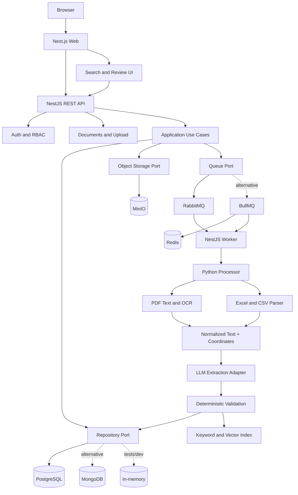

# Architecture Overview

## Trust boundaries

1. Browser is untrusted; all inputs are validated server-side.
2. Uploaded documents are hostile data, not instructions.
3. Python processor runs isolated, with bounded CPU/memory/time and no public exposure.
4. LLM output is untrusted and schema-validated before persistence.
5. Infrastructure adapters are replaceable and selected at bootstrap.
6. Secrets are injected through environment/secret management, never source code.
