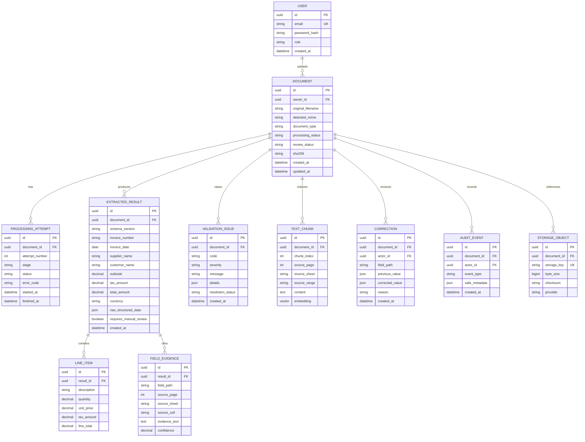

# Logical Database Schema

This is the provider-neutral logical model. PostgreSQL migrations are canonical; MongoDB documents/indexes must preserve these logical contracts. Refine physical types and constraints during implementation.

## Important constraints and indexes

- Unique storage key; unique document hash may be used for exact duplicate upload detection without assuming business-level duplicate invoice.
- Index `documents(processing_status, created_at)`.
- Index invoice normalized number and supplier/date for duplicate candidates.
- Index invoice date, supplier, currency and total for filters.
- Full-text index on searchable extracted text and invoice metadata.
- pgvector index selected based on vector dimension and measured dataset size.
- Foreign keys and transactions for PostgreSQL.
- Use decimal/numeric for financial values.
- Preserve immutable processing attempts and corrections.
- Keep large binary content in object storage, not database rows.
