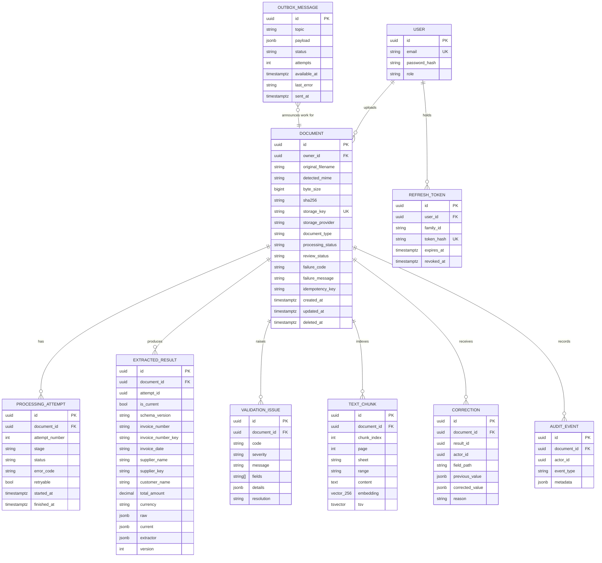

# Database schema

PostgreSQL migrations (`apps/api/prisma/migrations`) are canonical. The MongoDB adapter stores the same logical records as documents (collections named after the models, indexes created on connect).

## Design notes

- **Money** is `numeric(20,4)` for the filterable total and decimal **strings** inside the JSON (`raw`/`current`). No binary floating point anywhere in the money path (decimal.js, tolerance by ISO 4217 minor units).
- **Original vs corrected:** `raw` is the extraction exactly as first produced and is never updated; `current` holds `raw` plus human corrections. Every correction is also a row in `corrections` (who, which field, before/after, why). `version` provides optimistic concurrency.
- **Results are per attempt;** `is_current` marks the one the UI shows. Reprocessing never deletes earlier results or attempts.
- **Line items** are part of the result JSON (always read and edited together with their invoice). This differs from the earlier ERD sketch that proposed a table; it keeps corrections atomic.
- **Duplicate matching** uses the normalised `invoice_number_key` and `supplier_key` columns (lowercase alphanumerics) plus the `sha256` of the file for exact duplicates; both lookups are scoped to the owner.
- **Search:** `text_chunks.tsv` is a generated `tsvector` with a GIN index (keyword); `embedding` is `vector(256)` with an HNSW cosine index (semantic). Chunks keep `page`, or `sheet` + `range`, so results point at evidence.
- **Soft delete:** `documents.deleted_at` exists and every query filters it; no delete endpoint is exposed yet.
- **Outbox:** rows are written in the same transaction as the document and its first attempt (or a reprocess attempt) and drained by the relay with `FOR UPDATE SKIP LOCKED`.

## Indexes

`documents(processing_status, created_at)`, `documents(owner_id, created_at)`, `documents(sha256)`, unique `(owner_id, idempotency_key)`, unique `storage_key`; `extracted_results(document_id, is_current)`, `(invoice_number_key, supplier_key)`, `supplier_name`, `invoice_date`; `text_chunks(document_id, chunk_index)`, GIN on `tsv`, HNSW on `embedding`; `outbox_messages(status, available_at)`; unique `(document_id, attempt_number)`.

Prisma cannot express the `vector` extension, the generated `tsvector` column or the GIN/HNSW indexes, so they live in the hand-written migration `20261110000100_search_vectors`. `prisma migrate diff` therefore reports exactly those objects as "drift"; that is expected.
